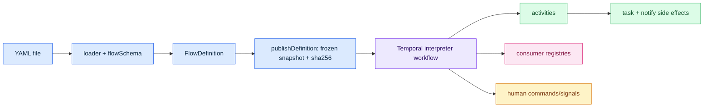
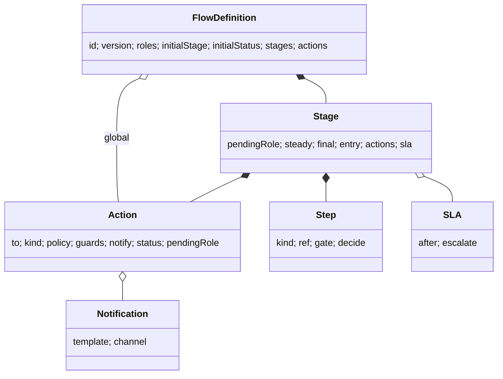
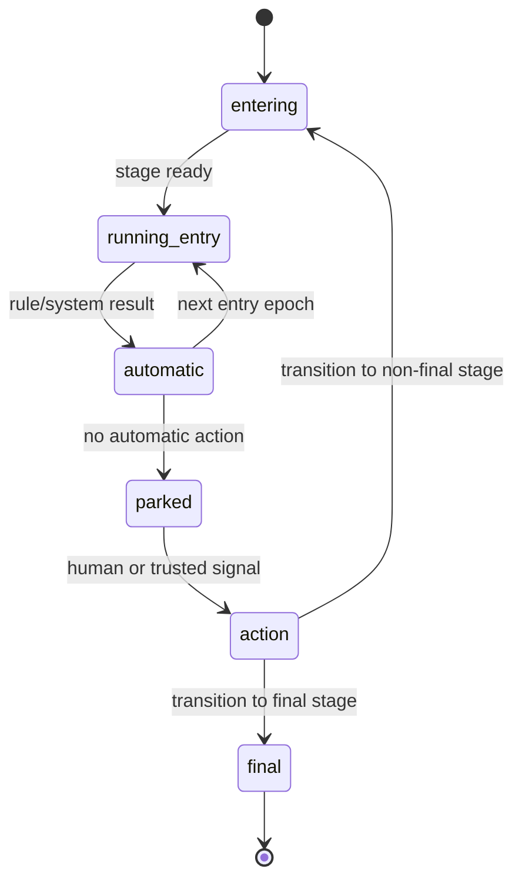
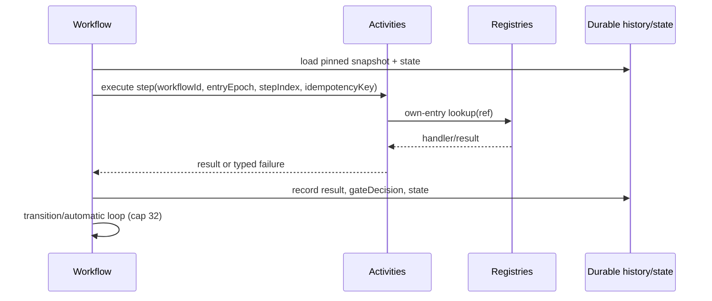
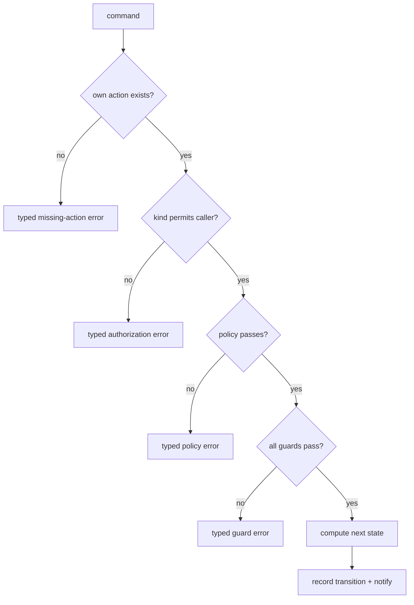
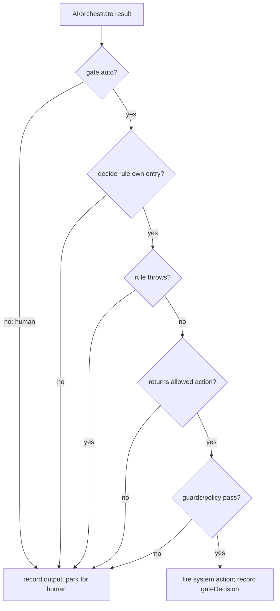
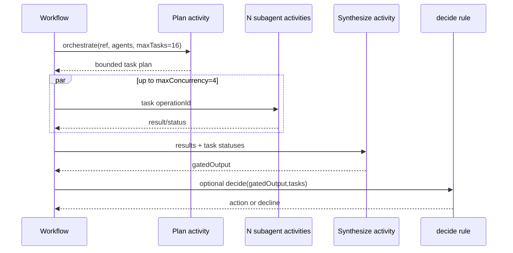
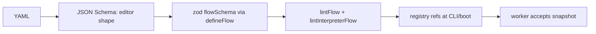
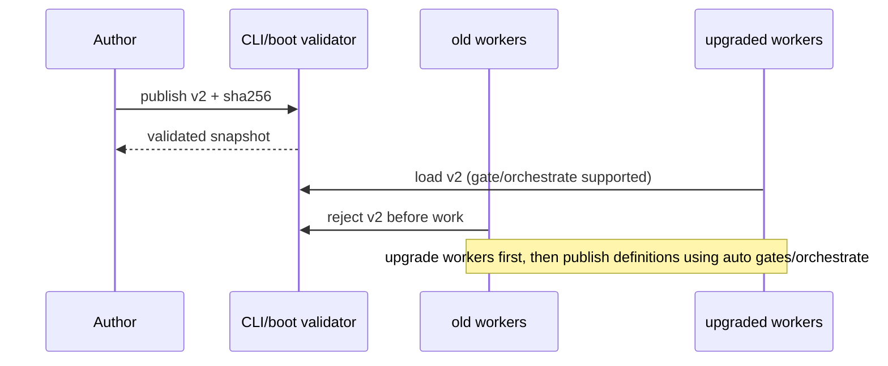
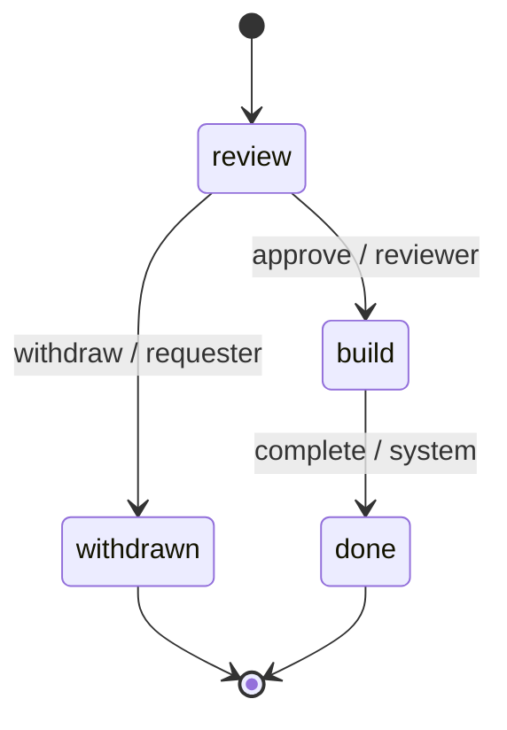

# FlowKit YAML definitions: technical deep dive

> **Scope and evidence.** This is a code-first guide for engineers and workflow authors. The loader runs outside Temporal; `FlowDefinition` is immutable data, and the workflow interprets a published snapshot. References use repository paths and line numbers from the `docs/yaml-deep-dive` checkout. Where the implementation is narrower than the design specs, this guide says so.

## 1. Mental model in one page

A YAML file is not executable workflow code. The definitions package parses and validates it, core supplies the data model and pure transition function, and Temporal interprets a pinned snapshot. Registries are supplied by the consumer; activities are the only side-effect boundary.



The workflow owns deterministic decisions, stage state, entry epochs, loop bounds, and replayable history. Activities resolve `system`, `ai`, and orchestration implementations and perform external work. Human commands are authorized through action policy and guards before the pure `transition()` result is applied.

## 2. Document anatomy

The authoritative structural contract is `packages/core/src/types.ts:1-132` and `schema.ts:1-374`; the YAML tables in `docs/definitions-yaml.md:35-151` mirror it. Top-level keys are:

| Key | Type / requiredness | Default and enforcement |
|---|---|---|
| `id` | string, required | non-empty schema (`schema.ts:133-140`) |
| `version` | positive integer, required | schema; YAML spelling must be exactly `version` (`yaml.ts:650-683`) |
| `roles` | non-empty string[] | duplicate/empty checks in schema |
| `tracks` | map of track name to string metadata | optional; schema |
| `initialStage` | string, required | must name a stage (`schema.ts:143-181`) |
| `initialStatus` | string, optional | runtime default `pending` (`transition.ts:178-179`) |
| `stages` | non-empty map, required | each stage validates below |
| `actions` | map, optional | global actions; applied to eligible non-final stages (`schema.ts:151-170`, `transition.ts:67-90`) |

A stage has `pendingRole?: string|null`, `steady?: boolean`, `final?: boolean`, `entry?: Step[]`, `actions?: Record<string,Action>`, and `sla?: {after:string, escalate?: string|{action:string}|{notify:string}}` (`types.ts:34-55`, `schema.ts:53-118`). An action has required `to` and optional `kind: human|system|signal` (default `human`), `policy`, `guards`, `notify`, `status`, and `pendingRole`; omitted `pendingRole` inherits the destination stage, while `null` clears it (`transition.ts:275-289`). Global actions use the same action shape and can be disabled per stage (`schema.ts:151-220`). Final stages cannot schedule entry work (`schema.ts:174-183`).

A step is `{kind: system|rule|ai|orchestrate, ref, ...}`. `ai` and `orchestrate` require `gate: human|auto`; `gate:auto` requires `decide`, and `decide` is rejected for other gates/kinds (`schema.ts:19-48`). Orchestrators additionally use `agents`, limits, retry/activity options, and require a registered orchestrator at boot.

```yaml
id: change-request
version: 1
roles: [requester, reviewer]
initialStage: review
initialStatus: pending
stages:
  review:
    pendingRole: reviewer
    entry:
      - {kind: ai, ref: assessRisk, gate: human}
    actions:
      approve: {to: deploy, kind: human, policy: reviewer, guards: [assessmentPresent]}
  deploy:
    entry:
      - {kind: system, ref: createTask}
    final: true
```

Runtime map: `stages.review.entry[0]` becomes an interpreter step input identified by `(workflowId, entryEpoch, stepIndex)`; `review.actions.approve` becomes an authorization-bearing transition; `pendingRole` drives role-scoped inboxes; `sla` schedules a durable timer and escalation action/notification.



## 3. Stage lifecycle and one interpreter turn





The documented default cap is 32 and can be changed with `FLOWKIT_AUTOMATIC_LOOP` (`workflow.ts` automatic-turn guard). Activity idempotency uses the structured workflow id, `entryEpoch`, and `stepIndex`; orchestration uses phase-specific operation keys (`contracts.ts` and `docs/definitions-yaml.md:146-151`). Durable Temporal history is the replay record; the snapshot hash is the definition identity, not a mutable database row.

## 4. Action kinds and authorization

`human`, `system`, and `signal` are the only action kinds (`types.ts:18-28`). Policy answers **who may fire**; guards answer **whether current state permits it**. `transition()` first finds an own action entry, checks kind/actor policy and then guards, and returns the next state or a typed `FlowkitTransitionError` (`transition.ts:93-299`). Missing refs and inherited names are not valid registrations: registry validation uses own-property checks, so `constructor`, `toString`, and `__proto__` remain missing (`cli.ts:150-171`, fixed by e5e67be).



## 5. Step kinds in depth

| Kind | Registry | Execution | Replay / idempotency | Output | Failure/degrade | lint |
|---|---|---|---|---|---|---|
| `system` | `systems` | activity | activity key; retry by options | task/side-effect result | typed activity failure | missing-system-ref |
| `rule` | `rules` | workflow-deterministic | replay-safe pure predicate | facts or automatic action | rule failure is typed; no unsafe transition | missing-rule-ref |
| `ai` | `ai` | activity | keyed result recorded in history | gated output only; never inherently a transition | human gate on decline/degrade; auto gate fails closed | missing-ai-ref |
| `orchestrate` | `orchestrators` | plan/synthesize + subagent activities | phase/task operation keys | bounded plan result, gated | partial/timeout state is exposed to gate; no implicit transition | missing-orchestrator-ref, orchestrate-without-sla |

`system` example:
```yaml
entry: [{kind: system, ref: createTicket}]
```
`rule` example:
```yaml
entry: [{kind: rule, ref: hasEnoughEvidence}]
```
`ai` example:
```yaml
entry: [{kind: ai, ref: summarizeChange, gate: human}]
```
`orchestrate` example:
```yaml
entry:
  - {kind: orchestrate, ref: implementChange, gate: human}
```

These four snippets are schema-valid shapes; the CLI also requires corresponding registry manifest entries for refs.

## 6. Gates

An AI/orchestrate output is a proposal. `gate: human` records it and parks the stage. `gate: auto` calls the named deterministic `decide` rule with the gated output (and orchestration task statuses); only a returned allowed action is fired. Missing rule, thrown rule, `undefined`/decline, or degraded step all fall back to a human. The model never decides its own authority.



## 7. `orchestrate` in depth

The implementation and spec describe plan -> bounded parallel task activities -> synthesize -> optional deterministic decide. `agents` names must be within the orchestrator registration. Defaults are `maxTasks=16` and `maxConcurrency=4`; registration may set explicit limits (`docs/definitions-yaml.md:132-151`, `cli.ts:278-300`). The consumer registers `orchestrators` in its manifest; the worker validates that section before accepting work.



The persisted replay material is the published snapshot/hash, plan, per-task status/result, phase operation IDs, synthesized output, and `gateDecision`. A partial failure, timeout, or degrade is represented in task status and is not silently treated as success; the gate therefore fails closed. **Implemented:** schema, manifest parsing, limits, operation-id shapes, activity calls, synthesis and auto-gate plumbing are present (`workflow.ts`, `contracts.ts`, `validation.ts`). **Spec intent / not fully verified here:** external consumers' specific planner, agent and synthesizer implementations; this repository supplies contracts and interpreter orchestration, not a universal model backend. `orchestrate-without-sla` is a semantic warning because bounded AI work needs a recovery boundary. Orchestrate output never transitions the flow by itself.

## 8. Validation layers



| Layer | Catches | Cannot catch |
|---|---|---|
| JSON Schema | editor shape/types | zod refinements such as AI gate/auto-decide rules |
| `flowSchema` | required fields, cross-field refinements, declared roles/stages | consumer registry membership |
| lint | semantic hazards, unbounded stages, missing refs when registry supplied | handler runtime behavior |
| boot/CLI registry validation | own refs, manifest shape, SLA duration | activity result correctness |

Lint codes in `types.ts:112-126` / `lint.ts:1-308`: `duplicate-role` duplicate role; `unused-role` role never used; `missing-stage-ref` action target absent; `missing-policy-ref` policy absent; `missing-guard-ref` guard absent; `missing-notify-ref` notification absent; `missing-system-ref` system absent; `missing-rule-ref` rule absent; `missing-ai-ref` AI absent; `missing-orchestrator-ref` orchestrator absent; `unbounded-stage` no SLA, steady marker, or automatic route; `orchestrate-without-sla` orchestration stage lacks SLA.

The YAML loader rejects `FlowDefinitionYamlError` for malformed/empty/multi-document YAML, merge keys, tags, non-string or duplicate keys, forbidden `__proto__`, wrong `version` spelling, alias expansion beyond 1000, schema errors, and inputs above 2 MiB; these prevent ambiguous or unsafe canonical data (`yaml.ts:45-110, 560-769`). `FlowDefinitionFileError` is only I/O/non-regular-file failure and carries `path`/`cause` without a source position (`yaml.ts:61-68, 816-860`). YAML 1.1-like booleans/nulls in keys must be quoted.

## 9. Determinism, pinning and replay

`publishDefinition()` normalizes, recursively sorts object keys, serializes canonical JSON, freezes the parsed snapshot, and computes `sha256:<64 lowercase hex>` (`snapshot.ts:27-153`). Thus YAML whitespace, comments, key order, and alias identity do not change the hash; semantic value changes, array order, version, or any added/removed key do. Hash-parity fixtures in `packages/temporal/src/snapshot.test.ts` prove equivalent object/key order produces one hash. In-flight workflows retain their pinned snapshot; publish a new version/hash for rollout.



The changelog rollout rule is explicit: older runtimes reject definitions using `gate:auto` or `orchestrate`; upgrade workers first.

## 10. Worked example: change request

```yaml
id: change-request-demo
version: 1
roles: [requester, reviewer]
initialStage: review
initialStatus: pending
stages:
  review:
    pendingRole: reviewer
    sla: {after: 10s, escalate: {notify: reviewerReminder}}
    entry:
      - {kind: ai, ref: assessRisk, gate: human}
      - {kind: ai, ref: classifyRisk, gate: auto, decide: approveLowRisk}
    actions:
      approve: {to: build, kind: human, policy: reviewer}
      withdraw: {to: withdrawn, kind: human, policy: requester}
  build:
    entry:
      - {kind: orchestrate, ref: implementChange, gate: human}
    sla: {after: 1h, escalate: {action: expire}}
    actions:
      complete: {to: done, kind: system}
  withdrawn: {final: true}
  done: {final: true}
actions:
  withdraw: {to: withdrawn, kind: human, policy: requester}
```

The checked-in leave fixture at `$TMPDIR/a5/leave.flow.yaml` is hash-parity-proven against its TypeScript definition. A real registry-aware validation from this checkout is:

```text
$ bun packages/definitions/src/bin.ts definitions validate packages/definitions/test/fixtures/cli-orchestrate.yaml --registries packages/definitions/test/fixtures/cli-orchestrate.registries.yaml
1 definition file(s) valid.
```

A deliberately broken fixture produces the real error line:

```text
$ bun packages/definitions/src/bin.ts definitions validate packages/definitions/test/fixtures/lane-b-f08-invalid.yaml --registries packages/definitions/test/fixtures/cli-orchestrate.registries.yaml
stages.draft.bogusKey:8:5 yaml-error Unrecognized key "bogusKey".
1 issue(s) across 1 file(s).
```

The illustrative command for a local change-request file is:

```sh
bun packages/definitions/src/bin.ts definitions validate change-request-demo.flow.yaml --registries manifest.yaml
```

The broken auto-gate variant is rejected by the schema with: `Step "classifyRisk" with gate "auto" must name a deciding rule in "decide".` This line is from `schema.ts:38`; it is not represented as a fabricated command transcript.



## 11. Operating it

Monitor workflow failures and typed `FLOWKIT_*` application failures, activity retries/timeouts, automatic-loop cap hits, gate declines/degrades, SLA timers/escalations, task concurrency, and definition hash/version. Version definitions immutably; validate registries at boot; upgrade workers before publishing new step semantics. `after: 10s` is a duration string, `steady` suppresses the unbounded-stage warning, and final stages cannot schedule work. Quote YAML keys that YAML 1.1 would coerce (`yes`, `off`, `null`, `~`).

## 12. Source map and doc drift

| Concept | Source |
|---|---|
| data model and enums | `packages/core/src/types.ts:1-132` |
| zod/refinements | `packages/core/src/schema.ts:1-374` |
| transition authorization/state | `packages/core/src/transition.ts:93-299` |
| lint codes/semantic checks | `packages/core/src/lint.ts:1-308` |
| workflow interpreter | `packages/temporal/src/workflow.ts:1-608` |
| activity contracts/operation IDs | `packages/temporal/src/contracts.ts:1-410` |
| boot validation | `packages/temporal/src/validation.ts:1-341` |
| canonical snapshot/hash | `packages/temporal/src/snapshot.ts:27-186` |
| YAML hazards/errors | `packages/definitions/src/yaml.ts:45-894` |
| CLI/manifest refs | `packages/definitions/src/cli.ts:150-903` |
| public YAML contract | `docs/definitions-yaml.md:1-525` |

### Doc drift found

- The prose specification describes universal planner/agent/synthesizer behavior, while this checkout implements the interpreter contracts and calls but leaves concrete consumer registries to applications; this guide labels that boundary rather than claiming a model backend.
- Some older plan prose calls the cross-cutting key `globalActions`; code and current YAML contract use top-level `actions` (`schema.ts:151`, `docs/definitions-yaml.md:35`).
- The requested standalone CLI transcript cannot be truthfully included without a manifest containing the illustrative refs; the structural error line above is source-grounded, not an invented run.
