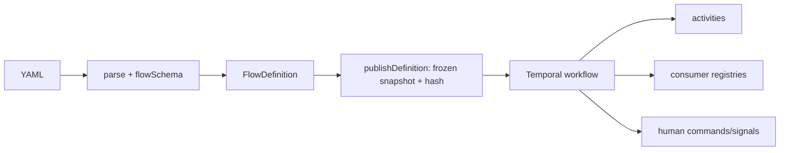
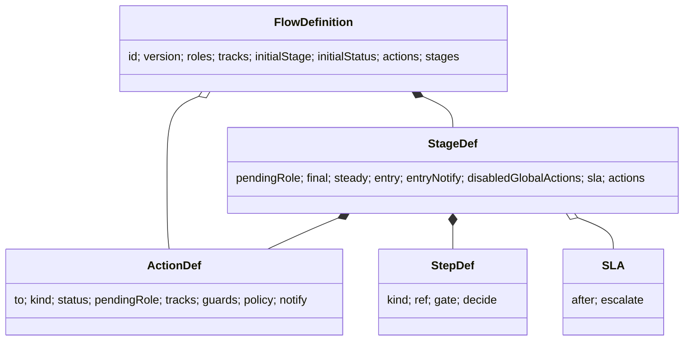
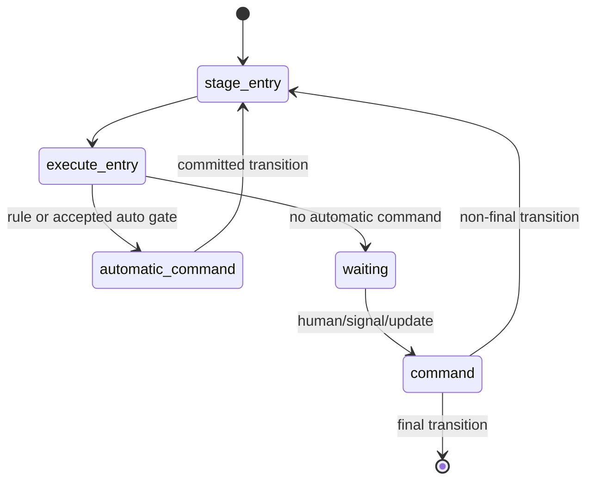
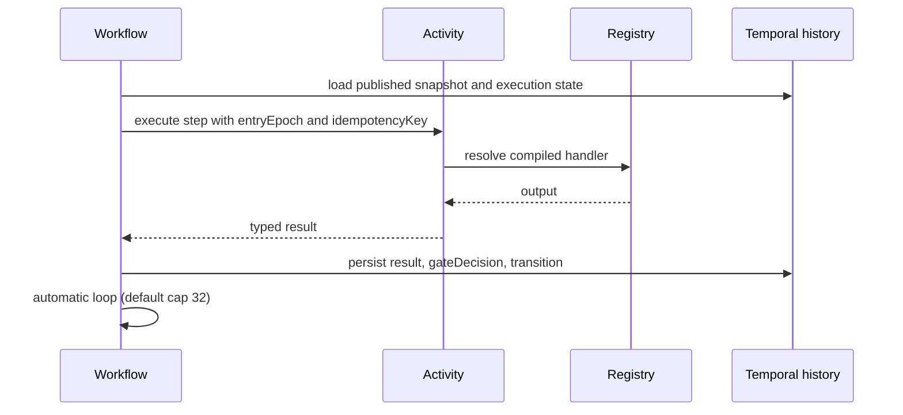
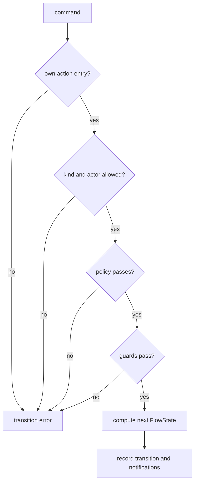
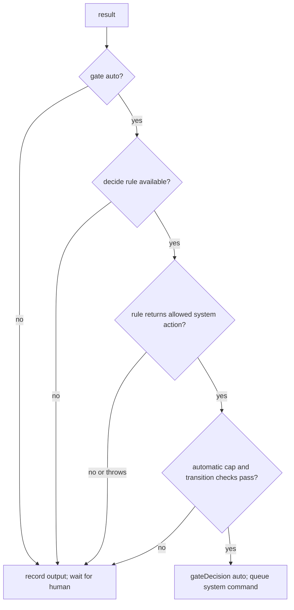
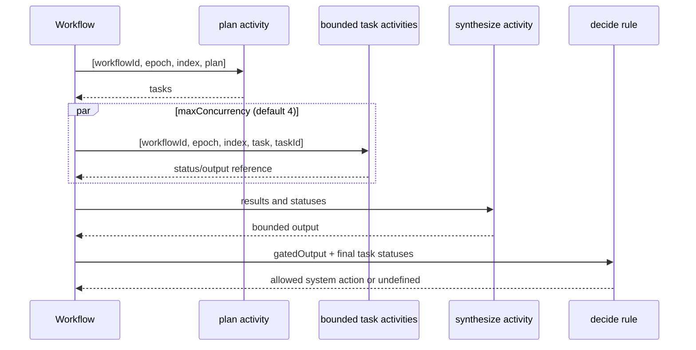
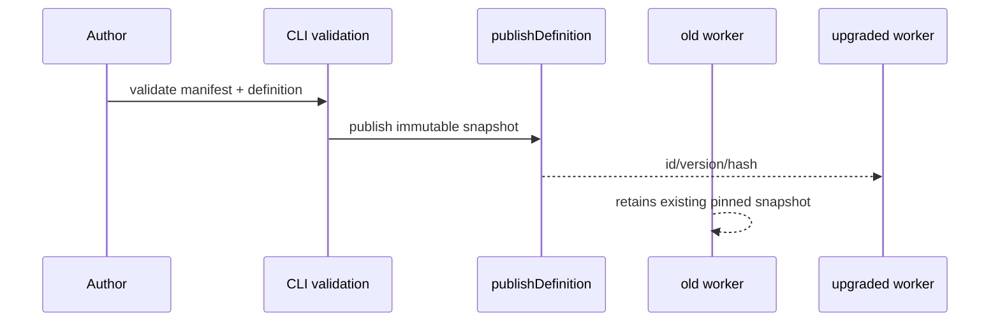
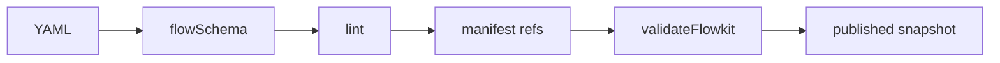
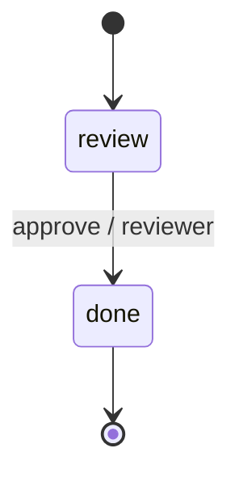

# FlowKit YAML definitions: technical deep dive

> **Scope and evidence.** This guide describes the checked-out implementation. Claims are traced to source symbols; line numbers are intentionally omitted where possible because they drift.

## 1. Mental model

Definitions are data. The definitions package parses YAML; core owns the data model, schema, lint, and pure transition; Temporal runs a published snapshot. Consumer registries supply handlers and pure functions. Activities are the side-effect boundary.



`FlowState` contains `stage`, `status`, `pendingRole: string | null`, and `tracks`. Published identity contains `id`, `version`, and `hash`.

## 2. Definition shape

`FlowDefinition` in `packages/core/src/types.ts` has exactly these top-level fields:

| Key | Meaning |
|---|---|
| `id` | non-empty definition identifier |
| `version` | numeric version |
| `roles` | declared role names |
| `tracks` | optional map of `{initial, values}` track definitions |
| `initialStage` | starting stage |
| `initialStatus` | optional initial status; the transition default is `pending` |
| `actions` | optional global action map |
| `stages` | stage map |

A `StageDef` may contain `pendingRole` (including explicit `null`), `final`, `steady`, `entry`, `entryNotify`, `disabledGlobalActions`, `sla`, and `actions`. An SLA has required `after` and `escalate`; escalation may specify `notify` and/or `action`. An `ActionDef` has `to`, optional `kind` (`human`, `system`, `signal`), `status`, `pendingRole`, `tracks`, `guards`, `policy`, and `notify`. Notifications have `template`, `channels`, and optional `to`.

A `StepDef` is `{kind, ref}` with kind `system`, `ai`, `rule`, or `orchestrate`. AI and orchestrate steps may use `gate: human|auto`; `gate: auto` requires `decide`, and `decide` is not valid for other step kinds/gates. Global `actions` is the code shape; prose using `globalActions` is drift.

```yaml
id: change-request
version: 1
roles: [requester, reviewer]
initialStage: review
initialStatus: pending
stages:
  review:
    pendingRole: reviewer
    entry: [{kind: ai, ref: assessRisk, gate: human}]
    actions: {approve: {to: done, kind: human, policy: reviewer}}
  done: {final: true}
```

The snippet is a **schema fragment**: it has no consumer manifest and is not claimed to pass registry-aware CLI validation.



## 3. Stage entry and interpreter turns

On a committed transition, `entryEpoch` increments. Entry step results are keyed by `entryEpoch:stepIndex`; each result records `ref`, `kind`, `status`, `entryEpoch`, and optionally `output`, `gateDecision`, or orchestration `tasks`. The automatic-transition cap defaults to 32 (`config.maxAutomaticTransitionsPerTurn ?? 32`). Exceeding it raises non-retryable `FLOWKIT_AUTOMATIC_LOOP`.





System and AI activity inputs include `workflowId`, `ref`, `definition`, `subject`, `state`, `entryEpoch`, `stepIndex`, serialized idempotency key, `entryReason`, and optional `priorTransition`. AI returns `{output?: unknown}`. The workflow records that output; it does not treat it as authority.

## 4. Actions, own entries, and authorization

Action kinds are exactly `human`, `system`, and `signal`. `transition()` resolves the declared action, checks kind/actor policy and guards, computes the next state, and applies status, pending-role, track, and notification effects. The explicit-null fix is in `packages/core/src/transition.ts`: destination `pendingRole` is inherited only when the action omits the field; `pendingRole: null` clears it.

Registry checks use own entries, not prototype lookup: `hasOwnRef`/`ownRef` in `packages/temporal/src/validation.ts` and `ownRef` in `packages/core/src/transition.ts`. The definitions CLI builds manifest sections with null-prototype objects. This keeps names such as `constructor`, `toString`, and `__proto__` from masquerading as registered refs. The old attribution to `cli.ts` is incorrect.



## 5. Step kinds and registries

The manifest section names in `packages/definitions/src/cli.ts` and `packages/temporal/src/contracts.ts` are `policies`, `guards`, `rules`, `orchestrators`, `systemSteps`, `aiSteps`, `templates`, and `channels`. The names `systems` and `ai` are not registry section names.

| Step | Registry section | Boot validation | Core lint ref check |
|---|---|---|---|
| `system` | `systemSteps` | missing `missing-system-step-ref` | `missing-step-ref` only when `validateRegistryRefs` gets a `steps` registry |
| `ai` | `aiSteps` | missing `missing-ai-step-ref`; auto gate also checks its rule | `missing-step-ref` only through the generic core registry helper |
| `rule` | `rules` | missing `missing-rule-ref`, unavailable action `rule-action-unavailable`, non-system action `rule-action-not-system` | not emitted by `lintFlow` |
| `orchestrate` | `orchestrators` | missing `missing-orchestrator-ref`, empty agents `orchestrator-agents-empty`, invalid limits `orchestrator-limit-invalid`; auto gate checks rule | not emitted by `lintFlow` |

The CLI says `Skipped: declared-ref validation (policies, guards, rules, system steps, AI steps, orchestrators, templates, channels)` when no manifest is supplied. CLI validation and boot validation are distinct from core `LintIssueCode`.

## 6. Exact lint contract

`lintFlow` emits every code below except `missing-action-policy`. `lintInterpreterFlow` starts with those results and additionally emits `missing-action-policy`. `validateRegistryRefs` emits the registry-oriented core codes shown below; it is not the Temporal boot validator.

| Code | Severity | Real trigger | Emitter |
|---|---|---|---|
| `unreachable-stage` | error | stage cannot be reached from `initialStage` by declared actions | `lintFlow` |
| `dead-end-stage` | error | non-final stage declares no actions, including global actions | `lintFlow` |
| `final-stage-has-actions` | error | final stage declares stage-local actions | `lintFlow` |
| `orchestrate-without-sla` | warning | non-final stage has an orchestrate entry step but no SLA | `lintFlow` |
| `unbounded-stage` | warning | non-final stage has no SLA, no rule entry, and is not `steady` | `lintFlow` |
| `unused-role` | warning | declared role is never referenced by pending role, notification recipient, or action | `lintFlow` |
| `unused-track` | warning | declared track is never updated by an action | `lintFlow` |
| `duplicate-action-source` | warning | same action name is declared on multiple stage-local sources | `lintFlow` |
| `missing-action-policy` | error | human or signal action lacks a policy; system actions are exempt | `lintInterpreterFlow` |
| `missing-step-ref` | error | generic `validateRegistryRefs` lacks `registry.steps[step.ref]` | `validateRegistryRefs` |
| `missing-guard-ref` | error | action guard is absent from `registry.guards` | `validateRegistryRefs` |
| `missing-policy-ref` | error | action policy is absent from `registry.policies` | `validateRegistryRefs` |
| `missing-template-ref` | error | notification template is absent from `registry.templates` | `validateRegistryRefs` |
| `missing-channel-ref` | error | notification channel is absent from `registry.channels` | `validateRegistryRefs` |

The exact `LintIssueCode` union has 14 members: the table above contains all of them. The fabricated names `duplicate-role`, `missing-ai-ref`, `missing-notify-ref`, `missing-orchestrator-ref`, `missing-rule-ref`, `missing-stage-ref`, and `missing-system-ref` are not lint codes.

## 7. Gates

For `gate: human`, the workflow records the step output and leaves the stage waiting. For `gate: auto`, the deciding rule receives `gatedOutput`; for an orchestrate step it also receives final task statuses. A returned allowed system action produces `gateDecision: { outcome: 'auto', action }` and a `gate:<entryEpoch>:<index>` command. A decline produces `{outcome: 'human'}`. A missing rule, thrown rule, invalid action, failed guards/policy, or degraded work does not release the stage. AI degradation is recorded as `status: degraded_to_human` and has no `gateDecision`. Orchestration failures similarly degrade to human.



## 8. Orchestration

`FLOWKIT_ORCHESTRATION_HARD_LIMIT` is 64. Defaults from `FLOWKIT_ORCHESTRATION_DEFAULTS` are `maxTasks: 16`, `maxConcurrency: 4`, `failFast: false`, and `maxOutputBytes: 65_536`. `workflow.ts` clamps the first two with `Math.min(..., FLOWKIT_ORCHESTRATION_HARD_LIMIT)`, while boot validation rejects registration values outside 1..64 with `orchestrator-limit-invalid`; it also requires non-empty `agents` (`orchestrator-agents-empty`). A plan over the effective task limit fails with the exact form `plan has N tasks, more than the limit of M`.

The activity identity is serialized as `[workflowId, entryEpoch, stepIndex, phase]`, with phase `plan`, `synthesize`, or `task`, `task` including `taskId`. Operation IDs used by the workflow are `orch:${epoch}:${index}` for an automatic orchestration transition, `gate:${entryEpoch}:${index}` for an auto AI gate, `sla:${entryEpoch}` for an SLA action/notification, and the incoming update ID for external commands. The plan, bounded parallel subagent activities, and synthesis run in activities. `failFast` cancels remaining tasks after the first failure; stale orchestration is superseded when the entry epoch changes; plan/task/synthesis/output-limit problems degrade to human. The workflow records task status/result references, synthesized output when successful, and gate decision in execution state/history; task outputs themselves are not kept in task state. The auto-gate rule receives final task statuses.



Concrete planner, agent, and synthesizer implementations remain consumer-provided contracts; this repository does not supply a universal model backend.

## 9. Validation, YAML safety, and snapshots

The layers are schema, core lint, then manifest/boot validation. `validateFlowkit` also verifies the published snapshot and parses positive SLA durations (`ms`, `s`, `m`, `h`, `d`, including compounds such as `1h30m`). The CLI exit kinds are `0` clean, `1` issues, `2` usage, `3` missing manifest, `4` malformed manifest, `5` unreadable definition, `6` unreadable manifest, `7` no files matched, and `70` internal error.

The YAML loader rejects malformed/empty/multi-document input, merge keys, tags, non-string or duplicate keys, forbidden `__proto__`, wrong version spelling, excessive alias expansion, schema failures, and inputs over 2 MiB. `publishDefinition` canonicalizes, recursively sorts keys, freezes the snapshot, and computes a `sha256:` hash. In-flight workflows retain their published snapshot.





## 10. Worked example and source map

The following is a **schema fragment**; it is not claimed to be a full definition or registry-valid CLI fixture:

```yaml
id: change-request-demo
version: 1
roles: [requester, reviewer]
initialStage: review
initialStatus: pending
stages:
  review:
    pendingRole: reviewer
    sla: {after: 10s, escalate: {notify: reviewerReminder}}
    entry: [{kind: ai, ref: assessRisk, gate: human}]
    actions: {approve: {to: done, kind: human, policy: reviewer}}
  done: {final: true}
```

This block is intentionally a structural example; its refs require a manifest. CLI validation is exercised separately by the mechanical check for this task using a real fixture and the real command `bun packages/definitions/src/bin.ts definitions validate <file> --registries <manifest>`.



### Source map

- `FlowDefinition`, enums, state and lint types: `packages/core/src/types.ts` (symbols `FlowDefinition`, `StepDef`, `ActionDef`, `LintIssueCode`)
- schema and cross-field checks: `packages/core/src/schema.ts` (`flowSchema`)
- transition semantics: `packages/core/src/transition.ts` (`transition`, `ownRef`, `getActionDefinition`)
- core lint: `packages/core/src/lint.ts` (`lintFlow`, `lintInterpreterFlow`, `validateRegistryRefs`)
- contracts and orchestration constants: `packages/temporal/src/contracts.ts` (`FlowkitDeclaredRefs`, `FLOWKIT_ORCHESTRATION_DEFAULTS`, `FLOWKIT_ORCHESTRATION_HARD_LIMIT`, activity inputs)
- boot validation: `packages/temporal/src/validation.ts` (`validateFlowkit`, `hasOwnRef`, `ownRef`, `FlowkitValidationIssue`)
- interpreter: `packages/temporal/src/workflow.ts` (`FLOWKIT_AUTOMATIC_LOOP`, gate and orchestration branches)
- manifest and CLI: `packages/definitions/src/cli.ts` (`MANIFEST_SECTIONS`, exit constants, `SKIPPED_NOTE`)
- YAML: `packages/definitions/src/yaml.ts`; snapshot: `packages/temporal/src/snapshot.ts`

### Doc drift found

- Older plan prose says `globalActions`; the code shape is top-level `actions`.
- Older prose says registries `systems` and `ai`; the implementation uses `systemSteps` and `aiSteps`.
- Core lint and Temporal boot validation use different code sets; names such as `missing-ai-ref` are not valid lint codes, while `missing-ai-step-ref` is a Temporal validation code.
- Consumer planner, agent, synthesizer, and activity implementations are contracts, not supplied universal behavior; this guide does not claim otherwise.
- `docs/definitions-yaml.md` is a separate public contract and may drift from code; this deep dive reports discrepancies rather than editing that file.
